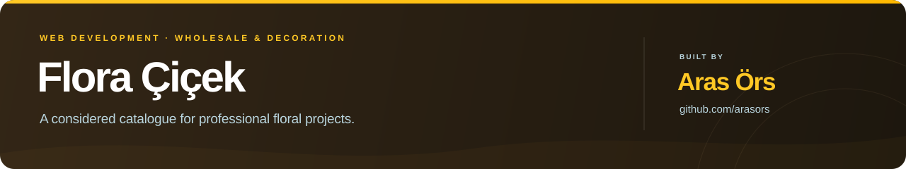
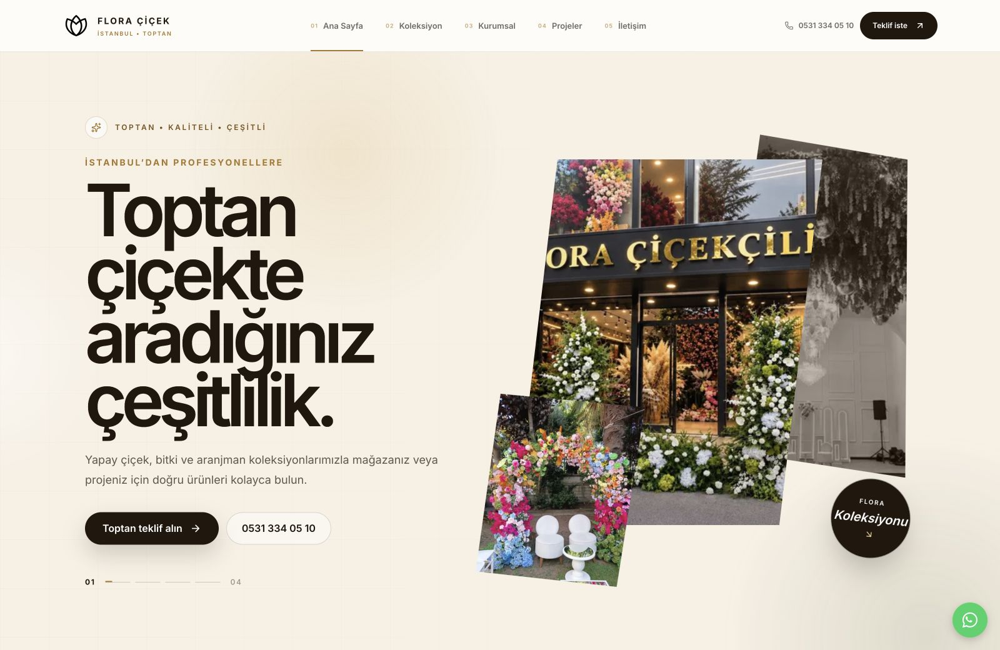
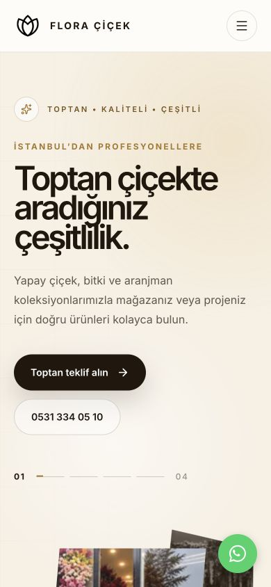

<p align="center">
  
</p>

<p align="center">
  A visual product catalogue for an Istanbul-based flower wholesaler,<br />
  connecting professional buyers with artificial flowers, plants and event collections.
</p>

<p align="center">
  <a href="https://flora-cicek.vercel.app/"><strong>Live preview ↗</strong></a>
  &nbsp;·&nbsp;
  <a href="#the-project">The project</a>
  &nbsp;·&nbsp;
  <a href="#features">Features</a>
  &nbsp;·&nbsp;
  <a href="#run-locally">Run locally</a>
  &nbsp;·&nbsp;
  <a href="#built-by">Get in touch</a>
</p>

<p align="center">
  <a href="https://flora-cicek.vercel.app/">
    
  </a>
</p>

<p align="center">
  <sub>Header and hero captured from the deployed website. Select the preview to explore the live experience.</sub>
</p>

<p align="center">
  <code>Next.js 16</code>&nbsp;
  <code>React 19</code>&nbsp;
  <code>TypeScript</code>&nbsp;
  <code>Tailwind CSS 4</code>
</p>

## The project

Flora Çiçek supplies artificial flowers, plants, trees, arrangements and event
products to stores, event companies and decoration professionals. The website
presents that range through a Turkish-language catalogue, real product photography
and direct wholesale enquiries by phone or WhatsApp.

The implementation brings together an animated landing page, 12 product-category
pages, a project gallery, business information, wholesale guidance and a
map-led contact page. Shared page templates keep the catalogue consistent while
allowing each product group to explain its own uses.

## Features

| Area | What is included |
| :--- | :--- |
| **Visual identity** | A warm ivory and gold palette, refined typography, brand-specific navigation and layered, angled product images. |
| **Hero & motion** | A four-story hero carousel, floating image panels, ambient background animation and scroll-triggered section reveals, with reduced-motion support. |
| **Product discovery** | 12 groups covering artificial flowers, plants, trees, arrangements, green walls and event products. |
| **Catalogue architecture** | 18 content pages, including the homepage, company pages and product pages built from typed content and a reusable template. |
| **Brand photography** | Supplied showroom and product images, with branded catalogue assets and separate inspiration and project galleries. |
| **Wholesale enquiries** | Phone links, WhatsApp calls to action and dedicated wholesale and contact pages. |
| **Mobile navigation** | A responsive layout and a full-screen mobile menu with direct access to the catalogue and contact details. |
| **Search & sharing** | Page metadata, canonical URLs, sitemap, robots, structured data, social metadata and LLM text files. |

<details>
  <summary><strong>View the mobile preview</strong></summary>
  <br />
  <p align="center">
    
  </p>
</details>

## Technology

| Layer | Tools |
| :--- | :--- |
| Application | Next.js App Router, React and strict TypeScript |
| Interface | Tailwind CSS, Lucide icons and reusable page sections |
| Content | Typed product and company data, shared inner-page templates and local image assets |
| Interaction | CSS animation and IntersectionObserver-based scroll reveals |
| Delivery | Vercel deployment, with standalone output retained for local and Docker builds |

## Run locally

Use **Node.js 24.x** and **Bun**.

```bash
git clone https://github.com/arasors/flora-cicek.git
cd flora-cicek
bun install --frozen-lockfile
cp .env.example .env.local
bun run dev
```

Open [localhost:3000](http://localhost:3000). Set `NEXT_PUBLIC_SITE_URL` to the
production origin before deployment so canonical links, the sitemap and sharing
metadata use the correct domain.

| Command | Purpose |
| :--- | :--- |
| `bun run dev` | Start the development server |
| `bun run check` | Run lint, TypeScript checks and the production build |
| `bun run build` | Create a production build |
| `bun run start` | Serve the production build |

<details>
  <summary><strong>Configuration and project structure</strong></summary>

### Configuration

- **Site URL, tracking and verification:** [`.env.example`](./.env.example)
  documents Google Analytics 4, Google Tag Manager, Yandex Metrica, Meta Pixel and
  Google, Yandex and Bing verification settings.
- **Products and contact details:** [catalogue data](./src/components/sites/flora-cicek/root-8a5edab2/data.ts)
  contains categories, navigation, image references, phone and WhatsApp details.
- **Inner-page copy:** [page content](./src/components/sites/flora-cicek/root-8a5edab2/innerPageData.ts)
  contains category introductions, company information and wholesale guidance.

Variables prefixed with `NEXT_PUBLIC_` are visible to the browser; keep private
credentials out of them.

### Structure

```text
src/app/                  Routes, metadata, sitemap and LLM files
src/components/sites/     Brand sections, catalogue data and inner-page templates
src/components/analytics/ Optional tracking integrations
src/components/seo/       Structured data
public/images/            Supplied showroom and product photography
public/sites/             Brand assets and prepared catalogue imagery
docs/readme/              Project header and live website screenshots
```

</details>

<details>
  <summary><strong>Maintaining the project showcase</strong></summary>

Keep the screenshots aligned with the shipped header and hero. The current
captures use the Turkish homepage at 1600×1040 and 390×844.

The [project README guide](./docs/PROJECT_README_GUIDE.md) records the shared
format for other repositories: project identity, a real interface preview,
verified features, local setup and author links.

</details>

## Built by

**[Aras Örs](https://github.com/arasors)** · Full stack engineer and founder of
[SENTROY](https://sentroy.com/).

For a website, a product build or an application that needs to move forward,
connect on [LinkedIn](https://www.linkedin.com/in/arasors/) or
[Upwork](https://www.upwork.com/freelancers/~01ee3382ccf6d07f2e).

<p align="center">
  <sub>Built by <a href="https://github.com/arasors">Aras Örs</a> · <a href="./LICENSE">MIT license</a></sub>
</p>
